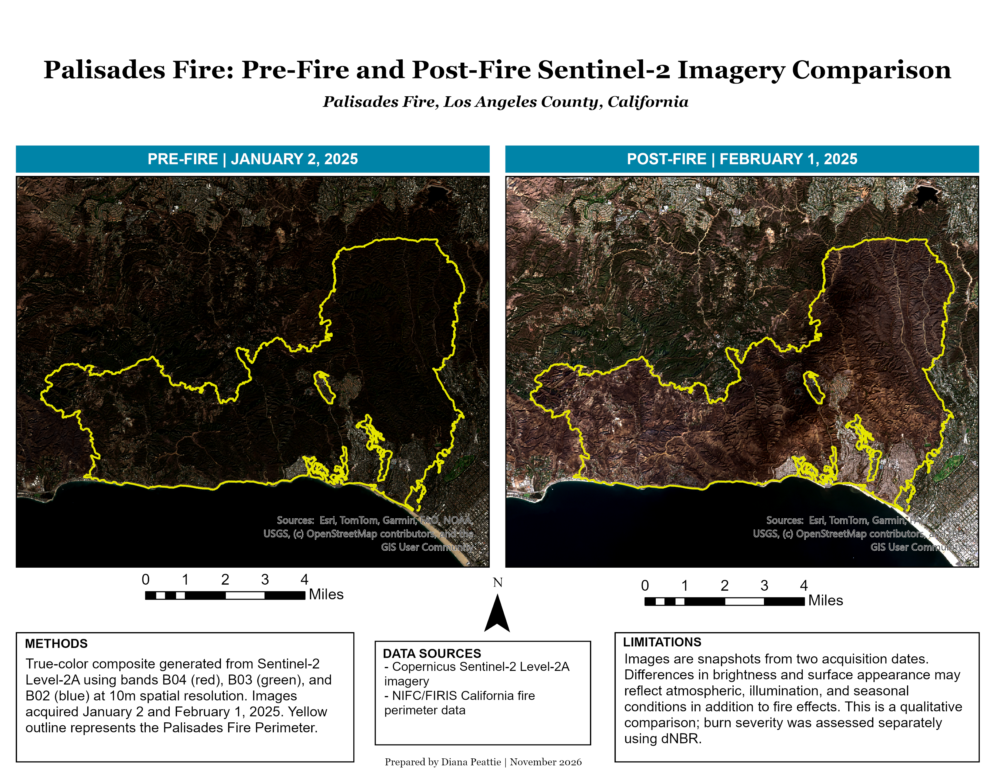
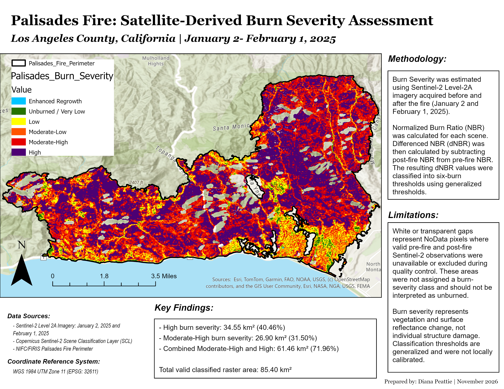
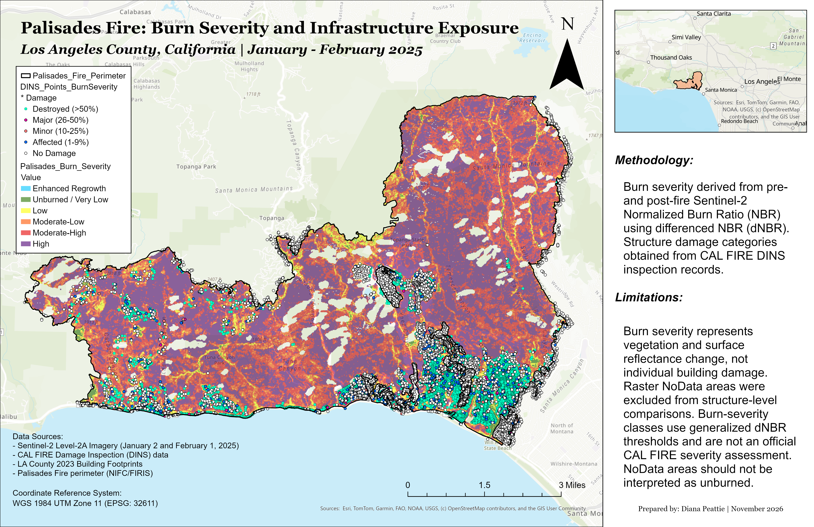

# Palisades Fire: Sentinel-2 Burn Severity and Infrastructure Exposure Assessment

### Project Overview:

This project examines vegetation change and observed building damage associated with the 2025 Palisades Fire in Los Angeles County, California.

Using Sentinel-2 Level-2A satellite imagery and CAL FIRE Damage Inspection (DINS) data, the analysis applies the Normalized Burn Ratio (NBR) and differenced Normalized Burn Ratio (dNBR) to classify relative burn severity and compare sampled burn-severity values with post-fire structure inspection outcomes.

#### Presentation Here: https://github.com/dianapt11/palisades_fire_assessment/blob/main/presentation/Palisades_Fire_Project_Report.pdf

### Research Question: How did the Palisades Fire affect vegetation, and how did observed building damage relate spatially to the burned area?

### Objectives:

- Compare pre-fire and post-fire Sentinel-2 imagery.
- Calculate NBR and dNBR to characterize vegetation and surface-condition change.
- Classify relative burn severity within the Palisades Fire perimeter.
- Integrate CAL FIRE DINS inspection records and building footprint data (for supporting infrastructure context).
- Examine the spatial distribution of observed structure damage in relation to sampled burn-severity classes.

### Study Area and Imagery:

Study Area: Palisades Fire, Los Angeles County, California

- Imagery:
    - Pre-fire
        - Acquisition date: January 2, 2025
    - Post-fire
        - Acquisition date: February 1, 2025

Sentinel-2 Level-2A imagery was used. True-color composites were created from bands B04 (red), B03 (green), and B02 (blue) at 10 m resolution.

For burn-severity analysis, B08 (near-infrared) was resampled from 10 m to 20 m to align with B12 (shortwave infrared 2) at 20 m.

### Data Sources:

- Copernicus Sentinel-2 Level 2A: Pre-fire and post-fire satellite imagery.
- [CAL FIRE DINS: Palisades Fire structure damage inspection records] (https://data.ca.gov/@cal-fire/palisades-fire-structure-status)
- [NIFC/FIRIS: California fire perimeter data] (https://www.arcgis.com/home/item.html?id=ad51845ea5fb4eb483bc2a7c38b2370c#overview)
- [Los Angeles County: Building footprint data] (https://services.arcgis.com/RmCCgQtiZLDCtblq/ArcGIS/rest/services/Buildings_2023_with_DINS/FeatureServer)

### Methodology:

1. **Image preprocessing and quality control**
Sentinel-2 imagery was prepared in ArcGIS Pro. Scene Classification Layer (SCL) information was used to mask cloud, shadow, and invalid pixels. Reflectance values were corrected using the BOA additive offset documented in the Sentinel-2 metadata.

2. **Normalized Burn Ratio**
NBR was calculated using near-infrared and shortwave-infrared reflectance:

        NBR = (NIR - SWIR2) / (NIR + SWIR2)

3. **Differenced Normalized Burn Ratio**
Pre-fire and post-fire NBR values were differenced:

        dNBR = NBR_pre-fire - NBR_post-fire

    The resulting dNBR raster represents changes in vegetation and surface conditions between the two image dates.

4. **Burn-severity classification**
The dNBR raster was classified into six categories using generic published dNBR thresholds:

    - Enhanced Regrowth
    - Unburned / Very Low
    - Low
    - Moderate-Low
    - Moderate-High
    - High

5. **Infrastructure exposure assessment**
CAL FIRE DINS inspection points were integrated with the burn-severity raster using Extract Values to Points in ArcGIS Pro. This allowed the burn-severity class at each valid sampled point to be compared with its recorded damage category. 

This analysis is descriptive: sampled raster values represent the surrounding 20 m pixel, not a direct measurement of burn severity at an individual building.

### Results:

- **Burn-severity distribution**
The classified raster contained 85.40 km2 of valid classified pixels.

| Burn-severity class | Area (km^2) | Share  |
| ------------------- | ----------- | ------ |
| Enhanced Regrowth   | 0.0136      | 0.02%  |
| Unburned / Very Low | 1.9472      | 2.28%  |
| Low                 | 8.9156      | 10.44% |
| Moderate-Low        | 13.0684     | 15.30% |
| Moderate-High       | 26.9028     | 31.50% |
| High                | 34.5528     | 40.46% |

Moderate-High and High classes together accounted for 61.46 km2 (71.96%) of valid classified pixels.

- **CAL FIRE DINS structure damage**

A total of 12,081 inspection records were included in the DINS point dataset.

| Damage Category  | Inspections | Share   |
| ---------------  | ----------- | ------- |
| Destroyed (>50%) | 6,845       | 56.66%  |
| No Damage        | 4,261       | 35.27%  |
| Affected (1-9%)  | 732         | 6.06%   |
| Minor (10-25%)   | 171         | 1.42%   |
| Major (26-50%)   | 72          | 0.60%   |
| **Total**        | **12,081**  | **100%**|

Of the 12,081 DINS points, 9,065 received valid burn-severity raster samples. The remaining 3,016 had NoData values.

Among the valid samples, Low and Moderate-Low burn-severity classes accounted for the largest share of observations in the destroyed and No Damage categories.

### Limitations:

- NoData areas resulted from image quality control and the availability of valid paired observations. They should not be interpreted as unburned areas.
- The classified raster represents valid pixels only and does not equal the official incident acreage.
- Generic dNBR thresholds were applied and were not locally calibrated.
- Differences in image brightness and surface appearance may reflect atmospheric, illumination, and seasonal conditions in addition to fire effects.
- dNBR measures vegetation and surface-condition change; it does not directly measure or predict building damage.
- DINS point samples represent the surrounding 20 m raster pixel, not building-level burn severity.
- Building footprint data and DINS inspection records are separate datasets and do not have interchangeable record counts.

### Tools & Technologies:

- ArcGIS Pro
- ArcGIS Pro Spatial Analyst Toolbox
- Sentinel-2 Level-2A
- Raster analysis
- NBR and dNBR

### Deliverables:

- Pre-fire and post-fire Sentinel-2 imagery comparison map
- Satellite-derived burn-severity map
- Infrastructure damage and burn-severity comparison map
- Technical presentation exported as PDF

#### Author: *Diana Peattie*
